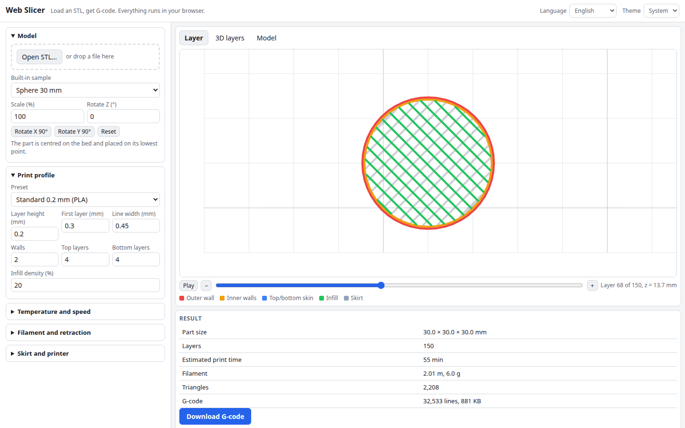

# Web Slicer

A simplified FDM slicer that runs entirely in your browser. Load an STL, and it slices the model into layers, builds walls, top and bottom skins and sparse infill, lets you scrub through every layer, and gives you G-code to download. Nothing is uploaded and there is nothing to install.

**Try it: [hermes98761234.github.io/web-slicer](https://hermes98761234.github.io/web-slicer/)**

[](https://github.com/hermes98761234/web-slicer/actions/workflows/deploy.yml)



## Features

- **Binary and ASCII STL** loading by file picker or drag and drop, plus built-in samples (cube, vase, sphere, torus, cylinder). Scale, rotate and auto-place on the bed.
- **Real slicing.** Triangle-plane intersection at each layer's mid-plane, segments joined into closed loops, holes and nested shells handled with an even-odd union.
- **Perimeters** by polygon offsetting (Clipper): 1 to 10 walls, inner walls printed before the outer one.
- **Top and bottom skins** found by comparing each layer with its neighbours, and **rectilinear infill** at any density that alternates 45° and 135° between layers.
- **Skirt**, first layer height, line width, retraction, fan from a chosen layer, temperatures and per-feature speeds. Presets for draft, standard, fine and PETG.
- **Preview** of any layer coloured by feature, a 3D stack of wall outlines, and a shaded model view you can rotate. A play button animates the build.
- **G-code** (Marlin flavour, relative extrusion) with an estimate of print time (acceleration-aware), filament length and mass.
- **English and Ukrainian**, light, dark or system theme. Settings are remembered in the browser.
- **Worker-based**: slicing runs in a Web Worker, so the page stays responsive and a setting change cancels the running job.

## How it works

1. `src/lib/slice.ts` finds, for every triangle, the layers whose plane it crosses and emits one segment per crossing. Vertices exactly on a plane count as above it, and edges are computed in a canonical vertex order, so neighbouring triangles agree to the micrometre. Segments are joined into loops and merged with an even-odd union.
2. `src/lib/toolpaths.ts` offsets each region inwards by half a line width per wall, then by the wall stack to get the infill area. A layer is solid where its infill area is not covered by the layers within the top/bottom skin count above and below. Solid areas get lines at one line-width spacing, the rest at `line width / density`.
3. `src/lib/gcode.ts` orders and writes the paths. Extrusion is `length x layer height x line width x flow / (pi x (filament diameter / 2)^2)`, and print time uses a trapezoidal speed profile at 1000 mm/s² acceleration.

Geometry runs in integer micrometres through [clipper-lib](https://github.com/junmer/clipper-lib) (Clipper 6). The unit tests check areas of sliced cubes, cylinders, spheres and tori against closed-form values, wall offsets, infill line length against density, extrusion maths and the G-code structure.

## Limitations

This is a teaching-grade slicer, not a replacement for Cura or PrusaSlicer. It has no supports, brims, bridging, ironing, seam control, or adaptive layers, and the time estimate ignores firmware look-ahead. Preview the G-code in a viewer and start with a test print. Non-watertight meshes are sliced as well as possible; unclosed outlines are skipped and reported.

## Quick start

You need [Node.js](https://nodejs.org/) 22.

```bash
git clone https://github.com/hermes98761234/web-slicer.git
cd web-slicer
npm install
npm run dev       # http://localhost:5173
npm test          # slicer, G-code, settings and i18n tests
npm run build     # static site in dist/
```

## License

MIT
